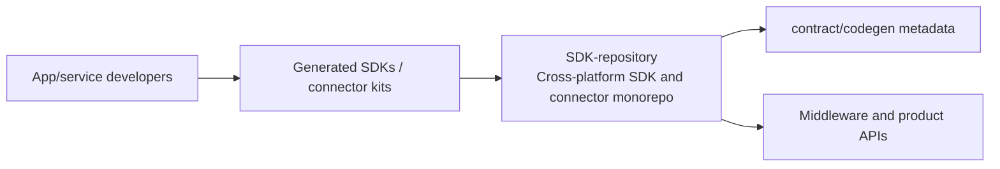
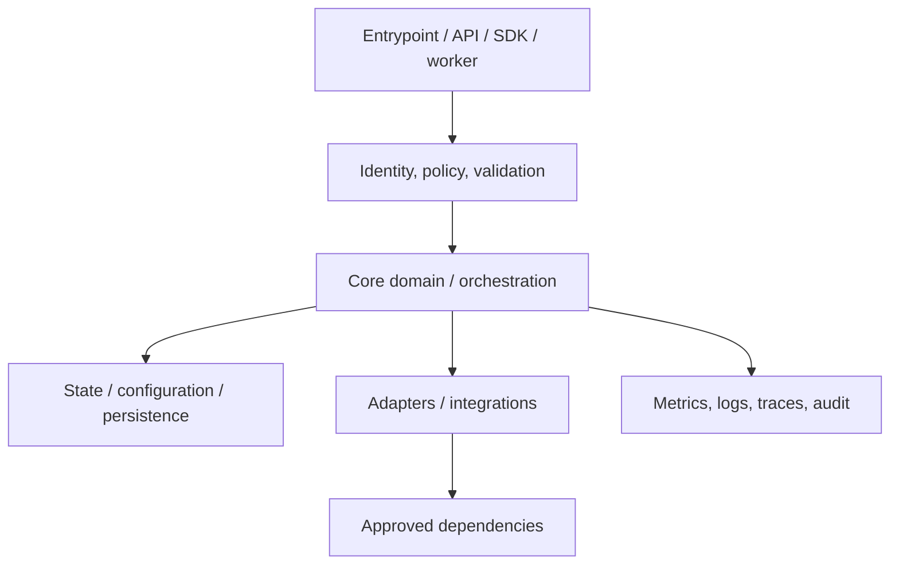
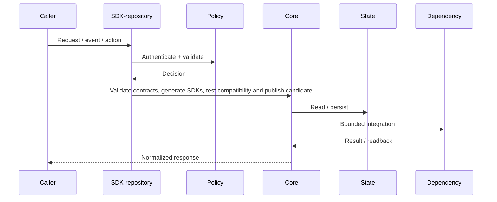
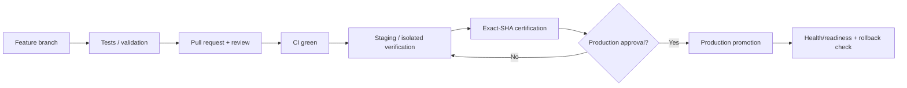
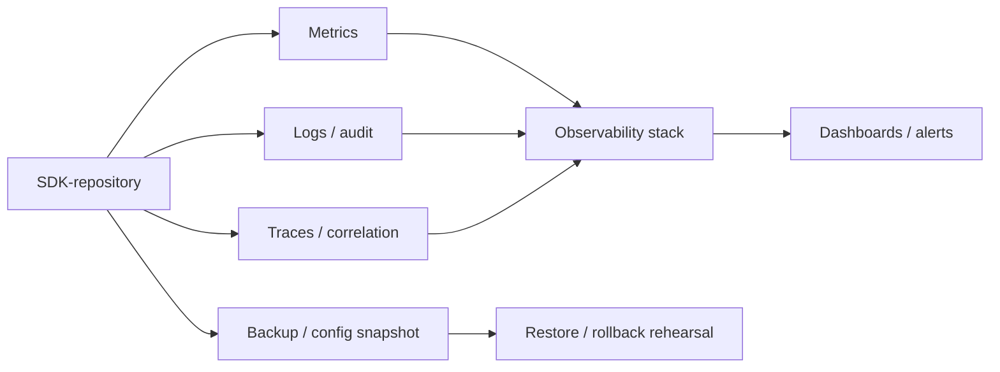

# SDK-repository — Architecture Charts

> Repository: `appolon1908/SDK-repository`  
> Baseline branch: `main`  
> Repository-local visual architecture. Update with code, contract and deployment changes.

## 1. System context

## 2. Internal component architecture

## 3. Critical flow

## 4. Deployment and promotion

## 5. Observability and recovery

## Ownership notes
- **Role:** Cross-platform SDK and connector monorepo
- **Primary boundary:** Generated SDKs / connector kits
- **State/config:** contract/codegen metadata
- **Dependencies/consumers:** Middleware and product APIs
- Cross-repository effects must use reviewed contracts; production effects remain separately gated.
